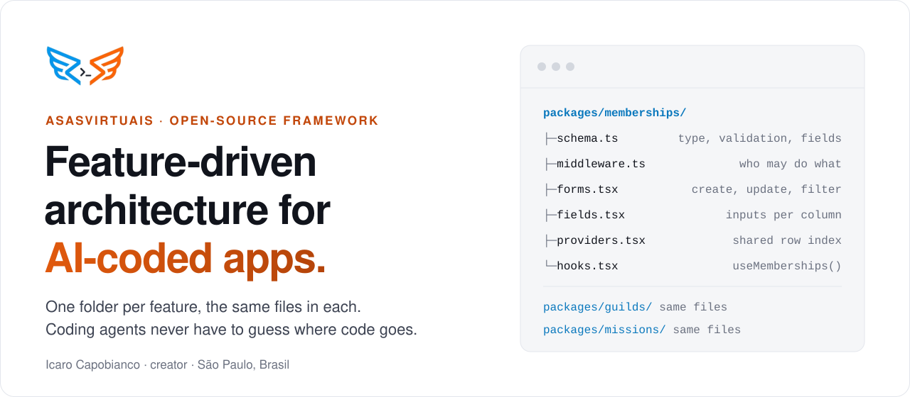
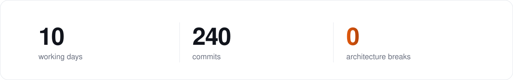

<picture>
  <source media="(prefers-color-scheme: dark)" srcset=".github/readme/hero-dark.svg">
  
</picture>

  <a href="https://github.com/asasvirtuais/asasvirtuais-framework"><b>Framework</b></a>&nbsp;&nbsp;·&nbsp;&nbsp;
  <a href="https://asasvirtuais.dev/never-broke-architecture"><b>Case study</b></a>&nbsp;&nbsp;·&nbsp;&nbsp;
  <a href="https://asasvirtuais.dev">asasvirtuais.dev</a>&nbsp;&nbsp;·&nbsp;&nbsp;
  <a href="https://linkedin.com/in/asasvirtuais">LinkedIn</a>&nbsp;&nbsp;·&nbsp;&nbsp;
  <a href="mailto:icaro@asasvirtuais.dev">icaro@asasvirtuais.dev</a>

 

I'm Icaro Capobianco, a software engineer in São Paulo. I created **[asasvirtuais](https://github.com/asasvirtuais/asasvirtuais-framework)**, a feature-driven (FDD) architecture framework for React and TypeScript apps written by coding agents.

AI-coded apps usually rot the same way: every session, the agent invents a new place for code and a new way to do the same thing. asasvirtuais makes those decisions once, up front, so the only questions left are about the product.

## How it works

Every feature is a folder with the same files as every other feature. Read one, and you know where everything is in the rest.

| File | What it owns |
| :--- | :--- |
| `schema.ts` | One zod schema per table: the TypeScript type, the validation and the form fields |
| `middleware.ts` | Every rule for the table: who can read, what is checked before a write, what runs after |
| `forms.tsx` | `CreateForm`, `UpdateForm`, `FilterForm`, which write into a shared row index so the UI never goes stale |
| `providers.tsx` · `hooks.tsx` | The table's rows, available to any component |

One CRUD interface (`find`, `list`, `create`, `update`, `remove`) routes each call to its table's middleware, so a security review means reading one file per table. An `AGENTS.md` tells any coding agent where each piece goes.

## Proof: a production app, built by an agent

<picture>
  <source media="(prefers-color-scheme: dark)" srcset=".github/readme/stats-dark.svg">
  
</picture>

A production multi-tenant app: role-based permissions per tenant, approval workflows, a marketplace with inventory and orders, AI generation throughout and web push. Claude Code built it on asasvirtuais from a written spec, from a phone. 50 commits changed the database schema, and the architecture held through every one of them.

**→ [Built by an agent. The architecture never broke.](https://asasvirtuais.dev/never-broke-architecture)**

## Experience

**Startup Labs** · Senior Full-Stack Engineer · 2026 – now 
Full-stack architecture for early-stage B2B SaaS products in Next.js, React and TypeScript.

**asasvirtuais** · Creator · 2025 – now 
The framework above, and Guild RPG built on it.

**Freelance** · Full-Stack Engineer · 2024 – 2025 
Top Rated on Upwork (4.8/5). Built CertWorld, an online courses platform, alone from spec to production.

**The Get Smart Group** · Web Developer · 2020 – 2021, 2022 – 2023 
React and TypeScript on WordPress and WooCommerce, including the Latham Pools lead-qualification configurator.

**SDK Co** · Developer Advocate, Web3 · 2021 – 2022

**Expert Ready** · WordPress Developer · 2019 – 2020

 

TypeScript · React · Next.js · Node.js · Zod · PostgreSQL · Airtable · Firebase · Vercel · AWS · Claude Code

Open to Full-Stack Engineer and Solutions Architect roles · CV in [English](https://asasvirtuais.dev/cv/Icaro-Capobianco-CV-EN.pdf) or [Português](https://asasvirtuais.dev/cv/Icaro-Capobianco-CV-PT.pdf)
