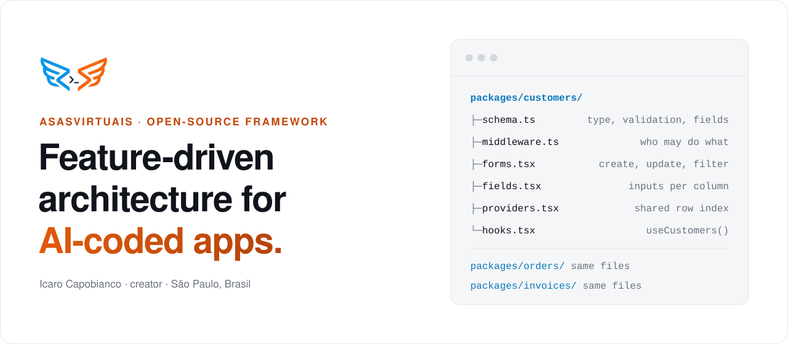
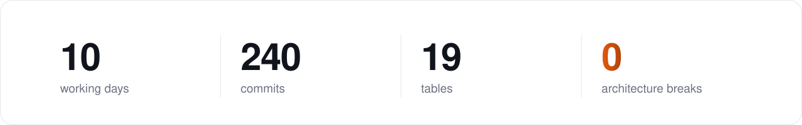

<picture>
  <source media="(prefers-color-scheme: dark)" srcset=".github/readme/hero-dark-3.svg">
  
</picture>

  <a href="https://github.com/asasvirtuais/asasvirtuais-framework"><b>Framework</b></a>&nbsp;&nbsp;·&nbsp;&nbsp;
  <a href="https://asasvirtuais.dev/never-broke-architecture"><b>Case study</b></a>&nbsp;&nbsp;·&nbsp;&nbsp;
  <a href="https://asasvirtuais.dev">asasvirtuais.dev</a>&nbsp;&nbsp;·&nbsp;&nbsp;
  <a href="https://linkedin.com/in/asasvirtuais">LinkedIn</a>&nbsp;&nbsp;·&nbsp;&nbsp;
  <a href="mailto:icaro@asasvirtuais.dev">icaro@asasvirtuais.dev</a>

 

I'm Icaro Capobianco, a software engineer in São Paulo. I created **[asasvirtuais](https://github.com/asasvirtuais/asasvirtuais-framework)**, a feature-driven (FDD) architecture framework for React and TypeScript apps written by coding agents.

AI-coded apps usually rot the same way: every session, the agent invents a new place for code and a new way to do the same thing. asasvirtuais makes those decisions once, up front, so the only questions left are about the product.

## [Built by an agent. The architecture never broke.](https://asasvirtuais.dev/never-broke-architecture)

<picture>
  <source media="(prefers-color-scheme: dark)" srcset=".github/readme/stats-dark-2.svg">
  
</picture>

A coding agent built a multi-tenant, subscription-based AI SaaS on asasvirtuais from a written spec. Ten problems that codebase never had:

1. No type updates by hand across dozens of files after a database change
2. No pile of server actions, each with its own access to the database
3. No state management written again on every screen
4. No permission checks scattered across unrelated files
5. No stale data, and no components fetching their own data
6. No business logic mixed with CRUD operations
7. No long server-side operations where simple steps would do
8. No new decision about where code goes, session after session
9. No different error-handling style in every file
10. No documentation drifting away from the code

**[Read the case study →](https://asasvirtuais.dev/never-broke-architecture)**

## Experience

**Startup Labs** · Senior Full-Stack Engineer · 2026 – now 
Full-stack architecture for early-stage B2B SaaS products in Next.js, React and TypeScript.

**asasvirtuais** · Founder · 2025 – now 
The framework above, and a multi-tenant, subscription-based AI SaaS I own and run on it.

**Freelance** · Full-Stack Engineer · 2024 – 2025 
Top Rated on Upwork (4.8/5). Built CertWorld, an online courses platform, alone from spec to production.

**The Get Smart Group** · Web Developer · 2020 – 2021, 2022 – 2023 
React and TypeScript on WordPress and WooCommerce, including the Latham Pools lead-qualification configurator.

**SDK Co** · Developer Advocate, Web3 · 2021 – 2022

**Expert Ready** · WordPress Developer · 2019 – 2020

 

TypeScript · React · Next.js · Node.js · Zod · PostgreSQL · Airtable · Firebase · Vercel · AWS · Claude Code

Open to Full-Stack Engineer and Solutions Architect roles · CV in [English](https://asasvirtuais.dev/cv/Icaro-Capobianco-CV-EN.pdf) or [Português](https://asasvirtuais.dev/cv/Icaro-Capobianco-CV-PT.pdf)
